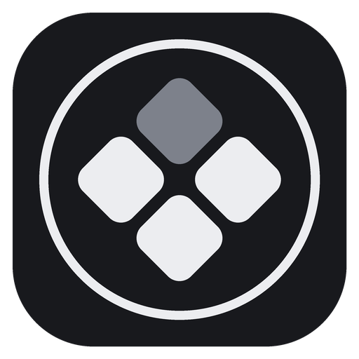
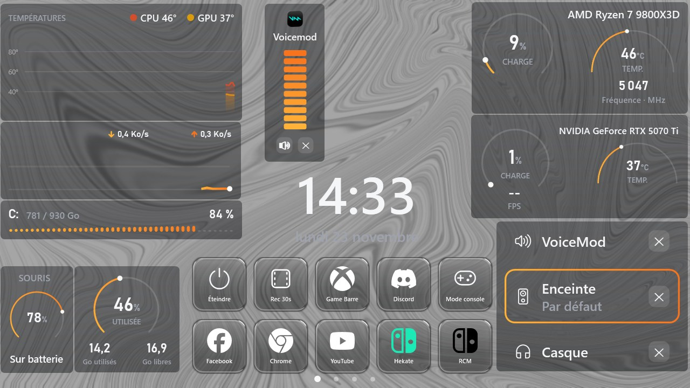
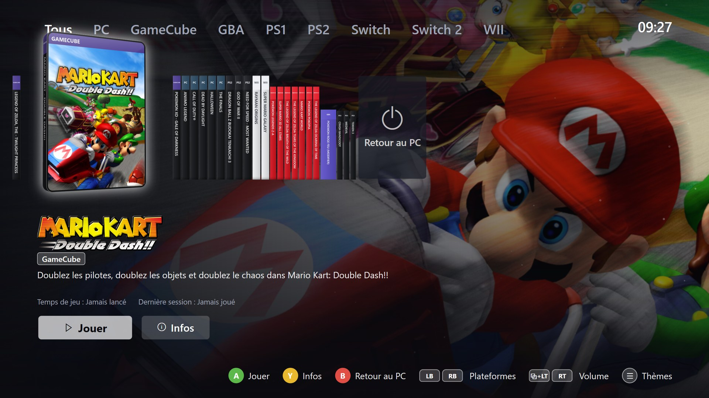
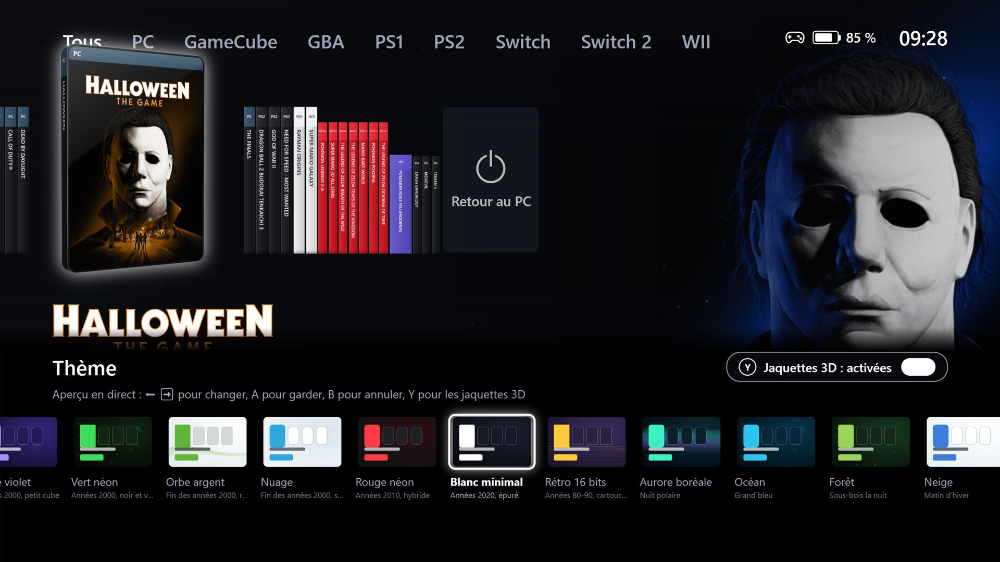

<p align="center"></p>

<h1 align="center">OXYN</h1>

<p align="center">
Widgets de bureau pour Windows + Nintendo Switch transformée en écran tactile / stream deck USB.<br>
<a href="README.md">English</a> · <b>Français</b>
</p>

---

OXYN (WPF, .NET 8) affiche des widgets rattachés au bureau (sous les fenêtres, comme les icônes) :
surveillance du matériel, audio, lecture en cours, horloges, calendrier, météo, consommation électrique en euros,
barre de raccourcis, barre de recherche et quota Claude. Tout est personnalisable depuis les Paramètres.

Avec le **payload SwitchDeck**, une Nintendo Switch branchée en USB-C devient un second écran tactile
1280×720 : le PC dessine les modules et les tuiles, la Switch les affiche et renvoie le tactile.
Les tuiles, en **boutons de verre 3D** façon Stream Deck, pilotent aussi **OBS Studio**, **Twitch** et **Voicemod**,
et des **plugins** : ceux d'OXYN et les plugins **Stream Deck d'Elgato** open source, à installer depuis un catalogue GitHub.
Les Joy-Con fixés sur la Switch peuvent aussi lancer des actions d'OXYN.

## Aperçu

<table>
  <tr>
    <td width="30%" valign="top"><br><sub>Widgets sur le bureau</sub></td>
    <td valign="top"><br><sub>La Switch branchée en USB-C : matériel, horloge et sortie audio en direct</sub></td>
  </tr>
</table>

<details>
<summary><b>Plus de captures</b></summary>

| | |
|---|---|
| <br><sub>Page Switch : aperçu en direct, pages, inspecteur de tuile et éditeur d'icône</sub> | <br><sub>Clic sur un widget de l'aperçu : tous ses réglages Switch en dessous</sub> |
| <br><sub>Vue Joy-Con : une action par touche, propre à une page si besoin</sub> | <br><sub>Choix des modules</sub> |
| <br><sub>Personnalisation d'un module : aperçu cliquable, carte, jauges, animations</sub> | <br><sub>Applications connectées : OBS Studio, Twitch, Voicemod</sub> |
| <br><sub>Alertes : température CPU et GPU, batterie de la souris, quota Claude</sub> | <br><sub>Général : mesure des FPS, éléments masqués, réinitialisation</sub> |

</details>

## Sommaire

- [Nouveautés de la version 2.5.0](#nouveautés-de-la-version-250)
- [Nouveautés de la version 2.4.0](#nouveautés-de-la-version-240)
- [Modules](#modules)
- [Compatibilité](#compatibilité)
- [Module Switch (SwitchDeck)](#module-switch-switchdeck)
- [Applications connectées (stream deck)](#applications-connectées-stream-deck)
- [Mode console](#mode-console)
- [Compiler](#compiler)
- [Organisation du dépôt](#organisation-du-dépôt)
- [Données](#données)
- [Dépannage](#dépannage)
- [Licences et crédits](#licences-et-crédits)

## Nouveautés de la version 2.5.0

**Ajouté**
- **Module Températures** (anciennement « Températures CPU / GPU ») : autant de courbes que tu veux sur le même graphe —
  processeur, CCD, carte graphique, point chaud, barrettes de mémoire, carte mère, SSD… Pour chaque courbe : donnée,
  libellé et couleur ; réglages du graphe : épaisseur des courbes, dégradé dessous, bas et haut de l'échelle.
- **Sorties audio et applications du mixeur** : chaque ligne a son propre cadre dans l'aperçu ; un clic ouvre ses
  réglages (nom affiché et icône de la sortie, icône de l'application) et chaque ligne se déplace ou se redimensionne
  seule, la liste et le module s'agrandissant en conséquence.
- **Éléments masqués** : liste « Éléments masqués » dans Personnaliser pour les réafficher un par un ou tous.
- **Anneaux ajoutés** : graduations au choix (traits, points, avec valeurs…).
- **Clic sur un widget du bureau** : si une page Personnaliser est ouverte, elle passe à ce widget.
- **Écran de la Switch** : placement plus précis (grille de 5 px, accroches plus douces, Alt pour placer librement) et
  **flèches du clavier** pour déplacer la sélection (1 px, Maj : 10 px).

**Modifié**
- Les cadres de l'aperçu suivent ce qui est dessiné ; un élément masqué n'a plus de cadre, ne sert plus d'accroche et ne
  compte plus dans la taille du module. Les bulles désactivées ou à 0 % ne comptent plus dans les cadres (sauf les
  lignes des sorties audio, qui réagissent au survol sur toute leur largeur).
- « Ajouter un élément » propose toutes les données des capteurs dès que les Paramètres sont ouverts.
- Curseur des bulles réglable jusqu'à 0 %.

**Corrigé**
- Le module Son ne bouge plus au survol des sorties audio.
- Champ « Données » aligné et plus large.

## Nouveautés de la version 2.4.0

**Ajouté**
- **Page Style**, en tête du menu : le style de **tous les widgets d'un coup** (thème, couleurs, police, fond, contour,
  bulles, opacités, arrondi, jauges, animations), puis les thèmes prêts à l'emploi et les profils.
- **Cinq dispositions** pour les modules Processeur, Carte graphique, Mémoire, Disques et Réseau : Classique (celle
  d'origine), Fiche technique (anneau et lignes « TEMPÉRATURE … 46 °C »), Tableau de bord (jauge en segments et barres),
  Compacte (grands chiffres) et Courbes (historique animé).
- **Éléments ajoutés** dans n'importe quel module : une donnée sous la forme de ton choix (anneau, barre, **courbe
  animée**, ligne de valeur, grand chiffre, titre, texte). Toutes les mesures du PC sont proposées : capteurs du
  processeur, de la carte graphique (point chaud, mémoire, ventilateurs…), barrettes de mémoire, carte mère, réseau,
  disques, FPS.
- **Plusieurs données dans un élément**, avec le calcul à faire : moyenne, maximum, minimum, somme (ex. 2 barrettes de
  16 Go = 32 Go) ou chacune affichée (« 32 / 33 °C »).
- **Personnalisation directement dans l'aperçu** : grille (4 à 16 px) et accroches (bords et centres des autres
  éléments et de la carte) ; on glisse un élément pour le placer, la molette change sa taille, Alt le place librement.
- **Clic sur un élément = tous ses réglages** au même endroit : donnée(s), forme, libellé, majuscules, taille, couleur,
  et pour une jauge sa **forme** (arc 270°, cercle complet, demi-cercle), son **style** (lisse, segments, compteur,
  néon…), son épaisseur ; pour un élément d'origine, aussi ses textes et ses boutons.

**Modifié**
- **Rien ne se modifie plus sur le bureau** : on y déplace seulement les widgets. Le clic droit garde « Personnaliser »,
  « Verrouiller » et « Masquer » ; Ctrl+molette et le mode « Déplacer les éléments sur le bureau » sont retirés.
- Personnaliser réorganisé : Disposition et éléments, Taille, Couleurs et polices du module, listes, options.

**Corrigé**
- VRAM affichée « -- » et quantités en octets (VRAM, capacité des barrettes, RAM utilisée) avec le pont des capteurs.
- Lignes inutiles retirées de la liste des données (seuils et résolution des capteurs des barrettes).

## Modules

| Id | Module | Source des données |
|---|---|---|
| `cpu`, `gpu`, `ram` | Processeur, carte graphique, mémoire | Pont des capteurs (LibreHardwareMonitor + PawnIO), sinon LibreHardwareMonitor dans OXYN |
| `network` | Débit réseau | Compteurs des interfaces réseau |
| `disk` | Disques | `DriveInfo` |
| `media` | Lecture en cours : 4 dispositions, barre de temps, aléatoire/répétition | API Windows.Media.Control (Spotify, navigateurs, VLC…) |
| `volumemixer` | Volume par application | Core Audio (NAudio) |
| `audio` | Sortie audio | Core Audio + IPolicyConfig |
| `mouse` | Batterie souris Logitech | HID++ 2.0 (HidSharp) |
| `power` | Consommation en € | Puissance GPU mesurée, CPU estimé, journal Windows pour le passé |
| `claude` | Quota d'utilisation Claude | Jeton de Claude Code (lu seulement) |
| `visualizer` | Visualiseur audio | Capture de la sortie audio (NAudio) |
| `tileclock` | Horloge à cases colorées (HH:MM:SS) | Horloge du système |
| `analogclock` | Horloge ronde à aiguilles avec la date | Horloge du système |
| `calendar` | Calendrier du mois | Horloge du système |
| `weather` | Météo et prévisions sur 4 jours | [Open-Meteo](https://open-meteo.com) (gratuit, sans compte) |
| `moon` | Phases de la Lune : vraie photo de la Lune ombrée selon la phase, nom de la phase, éclairement, prochaines phases | Calcul sans connexion (termes de Meeus, à quelques heures près) |
| `sun` | Lever et coucher du soleil : course du soleil, heures, durée du jour, prochain événement | Open-Meteo, même ville que la météo |
| `airquality` | Qualité de l'air (indice européen, PM2.5, PM10, NO₂, O₃) | Open-Meteo, même ville que la météo |
| `temperatures` | Courbes de toutes les températures choisies (processeur, carte graphique, barrettes, carte mère, SSD…) sur un même graphe | Pont des capteurs (LibreHardwareMonitor + PawnIO) |
| `sensorbars` | Barres pour n'importe quel capteur (températures, charges, RAM, VRAM, ventilateurs…) | Pont des capteurs (LibreHardwareMonitor + PawnIO) |
| `searchbar` | Barre de recherche (bureau seulement) : moteurs intégrés ou ajoutés, suggestions, favoris choisis, commandes `/xxx` pour l'IA de Google | Moteur choisi ; favoris pris dans Chrome, Edge, Brave, Opera ou saisis |
| `shortcuts` | Barre de raccourcis | `shortcuts.json` |

- **Barre de recherche** : module sans carte (fais glisser la barre pour la déplacer, clic pour taper). Entrée cherche
  avec le moteur choisi ou ouvre l'adresse tapée ; la pastille à gauche change de moteur (Google, Bing, DuckDuckGo, Brave,
  Ecosia, Qwant, YouTube, plus tes propres moteurs : un nom et une adresse avec `{texte}`, ou des sites prêts comme
  Wikipédia, Amazon, GitHub). Suggestions du moteur et favoris que tu choisis (depuis ton navigateur Chrome, Edge, Brave ou
  Opera, ou à la main) et renommes ; flèche à droite pour les parcourir. Commandes `/xxx` : aucune par défaut, tu ajoutes celles que tu veux
  (résumer, traduire, expliquer… envoyées au mode IA de Google, ou correction orthographique hors ligne) et tu les
  renommes. Couleur, opacité (barre et fenêtre de saisie), contour, largeur et hauteur réglables.
- **Sur le bureau** : on déplace les modules à la souris ; **clic droit** pour le personnaliser, verrouiller les
  positions ou le masquer. Tout le reste (disposition, éléments, tailles, couleurs) se règle dans **Personnaliser**.
- **Profils et thèmes** (page Style) : enregistrement, export/import (`.oxynprofile`), 9 thèmes prêts à l'emploi (dont « Edge noir » :
  cartes noires mates, jauges fines, accent orange).
- **Réglages des modules** : les options des horloges, de la météo, de la qualité de l'air, des températures, des barres de
  capteurs, de la barre de recherche et du lecteur sont dans la personnalisation du module (Apparence et options du module). Les nouveaux modules sont
  masqués tant qu'on ne les active pas.
- **Lecture en cours** : dispositions Compact, Bannière (grande pochette), Vinyle (disque qui tourne avec la pochette en
  étiquette) ou Pochette et disque ; barre de temps fine, épaisse ou en segments (un clic avance ou recule) ; boutons
  avec ou sans fond ; aléatoire et répétition. Pochette, morceau, barre de temps et boutons se déplacent.
- **Barres de capteurs** : n'importe quelle mesure, une barre horizontale (ou verticale) chacune ; segments, pleine ou
  dégradé, couleur par barre, halo, couleur d'alerte au-delà d'un seuil.
- **Sélecteur de couleur** : le sélecteur de Windows garde maintenant ses couleurs personnalisées.
- **Alertes** : température CPU/GPU, batterie de la souris, quota Claude.
- **Mises à jour sans GitHub** (Paramètres → Général → Mises à jour) : OXYN surveille un dossier (sur le PC, une
  clé USB ou un partage réseau) ; quand un `OxynSetup.exe` plus récent y est déposé, une bulle le signale au
  démarrage et **Mettre à jour OXYN** l'installe par-dessus (réglages gardés) puis relance l'application.

## Compatibilité

La plupart des informations fonctionnent sur n'importe quel PC Windows 10/11 sans réglage : charge du processeur,
mémoire, réseau, disques et carte graphique (NVIDIA, AMD ou Intel). Quelques exceptions :

- **Température du processeur, carte mère, ventilateurs, mémoire** : cocher l'option « Tous les capteurs » de
  l'installateur (une autorisation administrateur). Elle installe le pilote PawnIO et le pont des capteurs, une tâche
  planifiée lancée à l'ouverture de session, sans fenêtre.
- **Batterie de la souris** : seulement les souris Logitech compatibles HID++.
- **Ventilateurs** : ceux de la carte graphique sont lus sans réglage ; ceux de la carte mère (CPU, boîtier) avec le pont
  des capteurs. Les ventilateurs branchés sur un hub ou un contrôleur RGB ne sont lus que s'il est reconnu.

## Module Switch (SwitchDeck)

Le dossier [`payload/`](payload) contient un payload bare-metal lancé depuis
[hekate](https://github.com/CTCaer/hekate). Une fois lancé, la Switch attend OXYN sur le port USB-C.

- Pages de modules et de tuiles (applications, liens, raccourcis clavier, commandes, son/micro muet,
  OBS Studio, Twitch, Voicemod, plugins).
- Le widget **Tuiles de la page** peut avoir ses propres sous-pages, indépendantes des pages complètes de la Switch.
  Dans l'inspecteur d'une tuile, choisir **Page du widget → Nouvelle page** pour la déplacer et créer une sous-page,
  puis ajouter les actions **Page précédente** et **Page suivante** depuis la bibliothèque pour naviguer entre elles.
  Les flèches bouclent aux extrémités. Chaque tuile flèche peut aussi recevoir un bouton Joy-Con : il commande
  cette flèche sur la page Switch où elle est mappée et retrouve son affectation Joy-Con habituelle sur les autres pages.
- Actions système Switch dans la bibliothèque de la page : éteindre et démarrer en mode RCM, ou relancer hekate
  depuis `bootloader/update.bin` ou `payload.bin` sur la carte SD. Ces actions demandent un second appui pour éviter
  un déclenchement accidentel.
- **Page Switch des Paramètres façon Stream Deck** : aperçu en direct au centre, aperçus des pages en dessous et
  panneau de droite redimensionnable pour la bibliothèque d'actions et les réglages de la tuile ou de la commande
  Joy-Con sélectionnée. Cliquer sur une action ou la glisser sur une tuile ; le menu de gauche se masque (☰ ou Ctrl+B).
- **Éditeur de disposition** : déplacer et redimensionner directement les modules et leurs éléments dans l'aperçu,
  avec grille et guides d'alignement, ou sélectionner plusieurs éléments avec Ctrl+clic pour les déplacer ou
  redimensionner ensemble. Placement précis : grille de 5 px, Alt pour placer librement, flèches du clavier (1 px,
  Maj : 10 px). Appliquer une disposition équilibrée, jeu, monitoring ou compacte comme point de départ,
  puis l'ajuster librement. La grille de tuiles peut adapter automatiquement ses colonnes ou utiliser un nombre choisi.
- **Transitions entre les pages** : choisir aucune, glissement, fondu, glissement et fondu ou zoom, puis régler la
  durée et l'accélération.
- **Boutons en verre 3D** qui s'enfoncent à l'appui, ou tuiles à plat ; fond transparent possible. En style verre,
  les cases vides affichent des boutons vierges, comme les touches inutilisées d'un vrai Stream Deck.
- **Widget des tuiles façon Stream Deck** : fond arrondi facultatif (couleur ou texture : un grain noir est fourni et
  tu peux ajouter les tiennes), chaque bouton étant encastré dans son propre creux. La grille remplit le widget : des
  tuiles plus petites ajoutent des colonnes et des lignes (jusqu'à 16 × 9) et la place restante est répartie entre les cases.
- **Inspecteur des widgets et des tuiles** : un clic sur un widget dans l'aperçu Switch affiche juste en dessous tous
  ses réglages Switch (couleurs, carte, animations, textes, boutons, affichage ou masquage de chaque élément, taille à
  l'écran), avec un aperçu cliquable du widget. Pour une tuile : taille d'icône propre, indépendante du réglage de la
  page, et nom affiché ou masqué indépendamment des autres tuiles.
- **Chaque page a son style** : taille des tuiles et des icônes (jusqu'à remplir la tuile), verre ou plat, noms,
  fond (couleur, image), horloge. « Appliquer ce style à toutes les pages » en un clic.
- **Tuile active** (micro coupé, live en cours, scène active…) : couleur et deuxième icône au choix, bouton qui
  reste enfoncé.
- **Joy-Con** (payload v6) : les Joy-Con fixés sur la Switch (ou les commandes d'une Switch Lite) lancent des actions.
  La vue « Manettes (Joy-Con) » montre uniquement les deux manettes, dans un style neutre : clic sur une touche (ou
  action de la bibliothèque glissée dessus) pour lui donner une action de tuile, un changement de page, un curseur qui
  se promène sur les tuiles, le volume, ou l'accès direct à une page choisie (par exemple X → Home, Y → Media).
  Sticks : curseur, volume, souris ou défilement. Affectations communes à
  toutes les pages ou propres à une page. PC éteint, elles peuvent charger si la Switch reçoit une alimentation USB
  externe ; sur batterie, leur alimentation reste coupée pour préserver celle de la console.
- Les deux nouvelles actions système Switch nécessitent le payload SwitchDeck protocole v7 ou ultérieur.
- Glissement entre pages, curseurs au doigt, boutons VOL± = volume de Windows.
- **Mode nuit** : PC éteint, la Switch affiche une image et l'heure (horloge interne recalée par le PC).
- Menu (VOL+ et VOL- en attente) : éteindre, redémarrer, revenir à hekate.

| | |
|---|---|
| <br><sub>Températures, disque, réseau, RAM, CPU, GPU, Voicemod, horloge, tuiles en verre, sortie audio</sub> | <br><sub>Lecture en cours, visualiseur, Voicemod, sortie audio</sub> |
| <br><sub>Tuiles façon Stream Deck : plaque texturée, boutons en verre encastrés</sub> | <br><sub>Météo, horloge à cases, qualité de l'air, calendrier, Lune, quota Claude, barres de capteurs</sub> |

Installation : copier `payload/output/switchdeck.bin` dans `sd:/bootloader/payloads/` puis le lancer
depuis hekate (*Payloads*). Le pilote WinUSB est choisi automatiquement par Windows (descripteurs MS OS 2.0).

> Le payload s'exécute directement sur le matériel. Il ne modifie ni la NAND ni le système de la console,
> mais vous l'utilisez à vos risques.

## Applications connectées (stream deck)

Dans **Paramètres → Applications et plugins → Applications connectées**, **+ Ajouter une application** active OBS Studio, Twitch ou
Voicemod. On crée ensuite des tuiles de ce type depuis la bibliothèque d'actions de la page Switch. Les tuiles
affichent l'état en direct (scène active, live ou enregistrement en cours, mode actif, micro coupé…) et
s'atténuent quand l'application n'est pas connectée.

| Application | Connexion | Actions des tuiles |
|---|---|---|
| **OBS Studio** | Serveur WebSocket d'OBS 28+ (*Outils → Paramètres du serveur WebSocket*) : hôte, port, mot de passe | Changer de scène, stream, enregistrement et pause, caméra virtuelle, tampon de relecture et sauvegarde, couper une entrée audio, afficher/masquer une source, transition du mode Studio |
| **Twitch** | « Se connecter à Twitch » : code à valider sur twitch.tv, sans mot de passe dans OXYN | Clip (lien copié), marqueur, message dans le chat, pub, modes du chat (lent, émotes, followers, abonnés), mode bouclier, titre, catégorie |
| **Voicemod** | Voicemod lancé sur le PC ; autoriser OXYN dans Voicemod la première fois | Changeur de voix, charger une voix, voix au hasard, jouer un son du soundboard, arrêter les sons, micro, « M'entendre », ambiance |

- **Saisie sur la Switch** : une tuile Twitch *message*, *titre* ou *catégorie* peut demander son texte à
  l'appui. Un clavier AZERTY s'ouvre alors sur la Switch, avec les émotes Twitch du compte et une
  recherche de catégories avec jaquettes. Depuis le bureau, une petite fenêtre de saisie s'ouvre sur le PC.
- **Voicemod** : voix et sons choisis dans les listes de Voicemod, avec leur image comme icône. Les sons
  sont classés par soundboard, les vôtres en tête.

## Mode console

Jouer aux jeux du PC sur une TV branchée en HDMI, avec une interface de salon pilotée à la manette. Réglages dans
**Paramètres → Mode console**.

| | |
|---|---|
| <br><sub>L'interface TV : jaquettes, onglets par plateforme, temps de jeu et aide manette</sub> | <br><sub>Description du jeu et thème avec fond animé</sub> |
| <br><sub>Chaque thème change les couleurs, le fond et les images du jeu</sub> | <br><sub>Réglages : 21 thèmes, intro, bruitages, vibrations et jeux</sub> |
| <br><sub>Jaquettes 3D : jeux rangés tranche visible, le jeu choisi sort dans le boîtier de sa plateforme</sub> | <br><sub>Panneau des thèmes : aperçu en direct, Y active ou coupe les jaquettes 3D</sub> |

- **Bascule** : les écrans du PC s'éteignent, seule la TV reste active, le son part sur la TV. Au retour, la
  disposition des écrans, les icônes du bureau, les widgets et les applications (réduites pendant le mode) reviennent
  comme avant. Après un plantage, tout est remis au démarrage suivant. Raccourci de secours : **Ctrl+Alt+Fin**.
- **Interface TV** : jaquettes, fond animé, description, temps de jeu, batterie de la manette, 21 thèmes avec aperçu
  en direct (bouton Menu ≡). **Jaquettes 3D** (réglage, ou **Y** dans le panneau des thèmes) : les jeux sont rangés
  tranche visible, du plus grand boîtier au plus petit, et le jeu choisi sort en 3D dans un boîtier qui dépend de sa
  plateforme (formats et couleurs génériques, aucun logo).
- **Intro « Orbite »** avec sa bande-son : les 4 touches du logo jaillissent du centre et tournent en spirale en 3D
  pendant que la poussière lumineuse est aspirée, puis se verrouillent (onde de choc, éclat) et OXYN s'écrit. Ensuite
  « Appuyez sur A » puis « Bienvenue » (les particules sont soufflées) ; **A** pendant l'animation va directement à
  « Bienvenue », **B** passe l'intro.
- **Temps de jeu réels** : Steam (`localconfig.vdf`) et émulateurs Switch (Eden / yuzu et dérivés, Ryujinx), sinon le
  compteur d'OXYN.
- **Jeux** : programme `.exe`, raccourci `.lnk` / `.url`, lien `steam://`, ou émulateur + ROM (préréglages Dolphin,
  PCSX2, DuckStation, PPSSPP, RPCS3, Cemu, Ryujinx, Eden / yuzu, Xemu, mGBA, RetroArch). Jaquettes et descriptions
  depuis Steam, ou SteamGridDB avec une clé gratuite. Le jeu s'ouvre au premier plan ; le menu revient dès qu'il se
  ferme. **Quitter** (X) ferme le jeu (fin de tâche immédiate pour un émulateur).
- **Menu Guide** (appui court sur le bouton Xbox en jeu) : panneau à gauche avec batterie, temps de session et temps
  total, Reprendre, Triches, compteur FPS, Menu console, Quitter et Retour au PC. Le jeu est **mis en pause** tant
  qu'un menu est ouvert (réglage « Mettre le jeu en pause dans les menus »).
- **Compteur FPS** (réglage ou menu Guide) : en haut à droite de la TV, vert / jaune / rouge, mesuré par PresentMon.
- **Triches** (jeux d'émulateur Switch) :
  - **Recherche de valeurs** dans la mémoire de l'émulateur : chercher une valeur connue (vies, argent…), affiner,
    nommer, puis modifier (±1, ±10, valeur exacte) ou bloquer. Les valeurs sont retrouvées au lancement suivant
    (`console-cheats.json`).
  - **Codes de triche** au format Atmosphère : fichiers `.txt` ou recherche en ligne (switch-cheats-db, et
    [CheatSlips](https://www.cheatslips.com) avec un jeton gratuit), installés en add-ons de l'émulateur,
    désactivés par défaut, actifs au lancement suivant du jeu.
- **Souris** : le curseur disparaît en jeu après 2 s d'immobilité et revient en sortant du mode console.
- **Manettes** : Xbox et **Switch Pro / Joy-Con** (USB ou Bluetooth ; − = View, + = Menu, L / R = LB / RB, Home = bouton Xbox). Toutes les manettes connectées s'affichent en haut à droite avec leur batterie, et une notification discrète apparaît par-dessus le jeu, sans le déranger, quand une manette passe à 50 % puis devient faible (« Manette 1 · 50 % »).
- **Manette Xbox** :

| Action | Boutons |
|---|---|
| Lancer le mode console depuis le PC | **View ⧉ + Menu ≡** (modifiable : LB+RB+Menu, LB+RB+View) |
| Volume (menu et jeux) | **View ⧉ + RT** / **View ⧉ + LT** |
| Naviguer, jouer, retour | Croix ou stick, **A**, **B** |
| Plateformes / thèmes / infos / quitter le jeu | **LB RB** / **Menu ≡** / **Y** / **X** |
| Menu Guide pendant un jeu (pause, triches, FPS…) | Appui court sur le bouton Xbox |
| Revenir au menu pendant un jeu | Appui long sur le bouton Xbox |

### TV par le réseau (facultatif)

Avec une TV **Google TV / Android TV** sur le même réseau, OXYN peut l'**allumer** en entrant en mode console, la
passer sur l'**entrée HDMI du PC**, régler son **vrai volume**, et la **mettre en veille** au retour (deux options
séparées). Section **TV et manette** : *Rechercher*, *Appairer* (un code s'affiche sur la TV), puis choisir l'entrée
HDMI du PC et *Tester*.

| TV | Allumer / éteindre | Volume de la TV | Entrée HDMI du PC |
|---|---|---|---|
| Google TV / Android TV (Sony, TCL, Hisense, Philips, Xiaomi…) | Oui (*) | Oui | Oui : *Tester*, sinon *Trouver la méthode* |
| Samsung (Tizen), LG (webOS), Philips non Android | Non | Volume Windows | Non |
| TV non connectée au réseau | Non | Volume Windows | Non |

(*) Pour l'allumage depuis la veille, activer le réveil par le réseau sur la TV : *Wake on Wireless LAN* (Wi-Fi) ou
*Wake-on-LAN* (câble), parfois *Allumer avec Chromecast*. Chaque marque change d'entrée à sa façon :
**Trouver la méthode** essaie les méthodes connues une par une (la TV revient à l'accueil entre deux essais) et
retient celle qui affiche l'entrée du PC.

**Dépannage** : la TV ne s'allume pas (réveil réseau non activé, ou TV sur un Wi-Fi « invité » isolé du PC) ; la
TV clignote quelques secondes après la bascule (un écran DisplayPort du PC se met en veille et se déconnecte :
désactiver sa veille profonde) ; un émulateur se ferme tout de suite (voir `%AppData%\Oxyn\logs\oxyn.log`).

## Plugins et packs d'icônes

- **Plugins** : un plugin est un petit programme (exe, Node.js, Python ou PowerShell) relié à OXYN par un
  WebSocket local. Ses actions apparaissent dans la bibliothèque de la page Switch ; il peut changer le titre,
  l'image et l'état de ses tuiles en direct.
  - **Catalogue** (Paramètres → Plugins) : recherche sur GitHub (sujets `oxyn-plugin`, `streamdeck-plugin`),
    installation en un clic de la dernière version et mises à jour. Les plugins « Vérifiés » sont listés dans
    [plugins/catalogue.json](plugins/catalogue.json).
  - **Plugins Stream Deck d'Elgato** : les plugins open source (`.streamDeckPlugin` non chiffré, dossier
    `.sdPlugin`) fonctionnent, avec leur page de réglages affichée dans l'inspecteur (WebView2). Node.js est
    téléchargé une fois sur nodejs.org si le PC n'en a pas. Ceux du Marketplace d'Elgato sont chiffrés et ne
    fonctionnent pas ; les actions de molette (Stream Deck +) non plus.
  - Écrire un plugin : [docs/plugins.md](docs/plugins.md) et l'exemple [plugins/exemple-compteur](plugins/exemple-compteur).
- **Packs d'icônes** : dans le choix d'icône d'une tuile, **Pack d'icônes…** importe un pack au format du
  Stream Deck (`.streamDeckIconPack`, icônes SVG comprises), un zip ou un dossier d'images. Chaque pack devient
  une catégorie, avec recherche par nom et mots-clés. Une image (icône de pack monochrome) peut être recolorée.

## Compiler

### Application Windows

Prérequis : SDK .NET 8 et, pour l'installateur, [Inno Setup 6](https://jrsoftware.org/isinfo.php).

```powershell
# Développement et tests
dotnet build Oxyn.sln -c Debug
dotnet test Oxyn.sln

# Version publiée puis installateur (Oxyn\installer\output\OxynSetup.exe)
dotnet publish Oxyn\Oxyn.csproj -c Release -o Oxyn\bin\publish
dotnet build Oxyn.SensorBridge -c Release   # pont des capteurs, repris par l'installateur
& "$env:LOCALAPPDATA\Programs\Inno Setup 6\ISCC.exe" Oxyn\installer\Oxyn.iss
```

La version est définie dans `Oxyn.csproj` (`<Version>`) et doit être reportée dans
`installer\Oxyn.iss` (`MyAppVersion`).

La clé de la Control API de Voicemod n'est pas dans le dépôt : elle est intégrée à la compilation depuis
`Oxyn\Secrets\voicemod.key`, un fichier non versionné. Sans ce fichier, tout compile, mais l'intégration
Voicemod indique « clé absente ». Les clés sont délivrées par Voicemod. L'identifiant de l'application
Twitch est public et figure dans le code.

Argument de lancement : `--settings` ouvre les Paramètres. Lancer OXYN alors qu'il tourne déjà ouvre ses Paramètres.

### Payload Switch

Prérequis : [devkitPro](https://devkitpro.org/wiki/Getting_Started) avec devkitARM, et git.

```powershell
$env:MSYSTEM = 'MSYS'
& C:\devkitPro\msys2\usr\bin\bash.exe -l payload/build.sh          # sortie : payload/output/switchdeck.bin
& C:\devkitPro\msys2\usr\bin\bash.exe -l payload/build.sh clean
```

`build.sh` télécharge au premier lancement la BDK de hekate (version fixée, v6.5.4) dans `third_party/hekate`.

Le protocole USB est défini deux fois et doit rester identique :
`payload/src/deck_proto.h` (Switch) et `Oxyn/Deck/DeckProtocol.cs` (PC).

## Organisation du dépôt

```
├── Oxyn/                 Application WPF
│   ├── App.xaml(.cs)        Démarrage : instance unique, gestion globale des erreurs, icône de notification
│   ├── WidgetManager*.cs    Registre des modules, création des fenêtres, rafraîchissements
│   ├── Windows/             Fenêtres : cadre d'un module, Paramètres, ajout de raccourci/tuile
│   ├── Widgets/             Contenu de chaque module (XAML + affichage, sans logique métier)
│   ├── Controls/            Contrôles réutilisables : jauges, graphe, éditeur de thème, disposition libre
│   ├── Deck/                Module Switch : protocole et lien USB, rendu de l'écran, tuiles, clavier, mode nuit
│   ├── Console/             Interface TV du mode console : intros, jaquettes 3D, menu Guide, FPS, triches
│   ├── Services/            Logique métier et accès système (capteurs, audio, médias, consommation, profils,
│   │                        OBS, Twitch, Voicemod, packs d'icônes, SVG)
│   ├── Plugins/             Plugins : manifest (OXYN et Stream Deck), hôte WebSocket, Node.js, catalogue GitHub
│   ├── Infrastructure/      Transversal : chemins, journal, fichiers JSON sûrs, instance unique
│   ├── Interop/             Appels Win32/COM (bureau, raccourci global, clavier simulé, sortie audio)
│   ├── Converters/, Models/, Themes/, Assets/
│   ├── Tools/               Installation du pont des capteurs (tâche planifiée élevée), PresentMon (FPS)
│   └── installer/           Script Inno Setup
├── Oxyn.SensorBridge/      Pont des capteurs (.NET Framework 4.7.2, LibreHardwareMonitor + PawnIO)
├── Oxyn.Tests/           Tests xUnit
├── payload/                 Payload Switch en C (GPL-2.0)
├── plugins/                 Plugin d'exemple et liste des plugins vérifiés du catalogue
└── docs/                    Images de la documentation, guide des plugins
```

Règles suivies :

- **Un module défaillant n'arrête jamais les autres** : chaque lecture est protégée, les erreurs
  répétitives ne sont journalisées qu'une fois par session (`Log.WarnOnce`).
- **Aucune donnée perdue** : écriture atomique des fichiers ; un fichier illisible est mis de côté
  (`*.corrupt-date.json`) au lieu d'être écrasé.
- **Ressources système libérées** : objets COM audio, processus, handles d'icônes.

## Données

Tout est dans `%AppData%\Oxyn`. OXYN s'appelait auparavant **SysDeck** : au premier lancement, l'ancien dossier
`%AppData%\SysDeck` est déplacé tel quel vers `%AppData%\Oxyn` (réglages, jeux, thèmes, triches), et l'installateur
remplace l'ancienne installation.

| Fichier / dossier | Contenu |
|---|---|
| `config.json` | Réglages, thème, apparence des modules, positions, Switch, applications connectées. Le mot de passe OBS et les jetons Twitch y sont chiffrés (DPAPI, compte Windows courant) et ne sont jamais exportés dans les profils. |
| `shortcuts.json` | Raccourcis de la barre |
| `custom-colors.json` | Couleurs personnalisées du sélecteur de couleur |
| `power-usage.json` | Historique de consommation |
| `console-games.json`, `console-state.json` | Jeux du mode console ; état à restaurer après un plantage |
| `console-cheats.json`, `cheat-codes.json` | Valeurs de triche enregistrées ; codes de triche par jeu |
| `Icons/`, `Backgrounds/`, `Fonts/` | Copies des icônes, images de fond et polices importées |
| `IconPacks/` | Packs d'icônes importés (SVG convertis en PNG) |
| `Plugins/`, `logs/plugins/` | Plugins installés et leur journal |
| `Runtime/`, `WebView2/` | Node.js téléchargé pour les plugins, profil du moteur des pages de réglages |
| `logs/oxyn.log` | Journal (1 Mo max, l'ancien est conservé en `oxyn.old.log`) |

La variable d'environnement `OXYN_DATA_DIR` permet d'utiliser un autre dossier (tests, profil
portable) ; une instance par dossier de données.

## Dépannage

- **Un module reste vide** : consulter `%AppData%\Oxyn\logs\oxyn.log`.
- **Température CPU ou capteurs de la carte mère absents** : réinstaller OXYN en cochant « Tous les capteurs ». Le
  déroulement est noté dans `C:\ProgramData\Oxyn\install-sensors.log`, le fonctionnement du pont dans
  `C:\ProgramData\Oxyn\sensor-bridge.log`. PawnIO doit apparaître dans les applications installées de Windows ;
  si le pont n'écrit plus, OXYN relance lui-même sa tâche.
- **Le bouton Xbox n'ouvre pas le menu Guide** : désactiver dans Windows « Ouvrir la Game Bar avec le bouton Xbox » ;
  Steam Input peut aussi prendre le bouton.
- **Codes CheatSlips : « Quota exceeded for today »** : le compte gratuit a une limite par jour, réessayer le lendemain.
- **Switch non détectée** : vérifier que le payload affiche « En attente du PC » et utiliser un câble USB-C de données.
- **Joy-Con sans effet** : copier le dernier `switchdeck.bin` sur la carte SD ; l'onglet Manettes prévient
  si le payload est trop ancien.
- **Barre de recherche sans favoris** : aucun favori n'est mis d'office ; les ajouter dans la personnalisation du module.
  « Ajouter depuis le navigateur » lit seulement les navigateurs Chromium (Chrome, Edge, Brave, Opera), et uniquement
  celui défini comme navigateur par défaut dans Windows ; sinon, « Ajouter à la main ».
- **Barre de recherche : « / » ne propose rien** : aucune commande par défaut ; les choisir dans la personnalisation du module.
- **Météo, qualité de l'air ou soleil vide** : choisir la ville dans la personnalisation du module (Apparence et options du module), puis « Rechercher ».
- **Application connectée en erreur** : la carte de l'application (Paramètres → Applications et plugins)
  indique la raison. Vérifier qu'OBS ou Voicemod est lancé. Pour Twitch, se déconnecter puis se reconnecter
  après une mise à jour qui demande de nouveaux droits (émotes).

## Licences et crédits

- Application Windows (tout sauf `payload/`) : [MIT](LICENSE).
- Payload Switch (`payload/`) : [GPL-2.0](payload/LICENSE), car il repose sur la BDK de
  [hekate](https://github.com/CTCaer/hekate) (CTCaer, naehrwert).
- [LibreHardwareMonitor](https://github.com/LibreHardwareMonitor/LibreHardwareMonitor) (MPL-2.0),
  [NAudio](https://github.com/naudio/NAudio) (MIT), [HidSharp](https://www.zer7.com/software/hidsharp) (Apache-2.0).
- [PresentMon](https://github.com/GameTechDev/PresentMon) (Intel, MIT) pour la mesure des FPS.
- Police [Inter](https://github.com/rsms/inter) (SIL Open Font License 1.1) pour les écrans du payload Switch.
- [PawnIO](https://pawnio.eu) (namazso, GPL-2.0), pilote d'accès au matériel, installé tel quel par l'installateur officiel.
- Logos de marques : [Simple Icons](https://simpleicons.org) (CC0) — les marques appartiennent à leurs propriétaires.
- [SharpVectors](https://github.com/ElinamLLC/SharpVectors) (BSD-3-Clause) pour les icônes SVG,
  [WebView2](https://developer.microsoft.com/microsoft-edge/webview2/) (Microsoft) pour les pages de réglages des plugins,
  [Node.js](https://nodejs.org) (MIT, téléchargé à la demande) pour les plugins en JavaScript.
- Données météo, qualité de l'air, lever et coucher du soleil : [Open-Meteo.com](https://open-meteo.com) (CC BY 4.0).
- Image de la Lune : carte couleur LROC du Scientific Visualization Studio de la NASA ([CGI Moon Kit](https://svs.gsfc.nasa.gov/4720)), projetée en disque.

Nintendo Switch et Joy-Con sont des marques de Nintendo. Stream Deck et Elgato sont des marques de Corsair. OBS Studio, Twitch et Voicemod sont
des marques de leurs propriétaires respectifs. Ce projet n'est ni affilié ni approuvé par Nintendo, Corsair, OBS, Twitch ou Voicemod.
